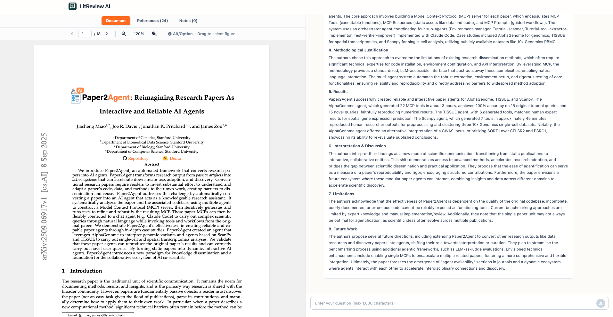
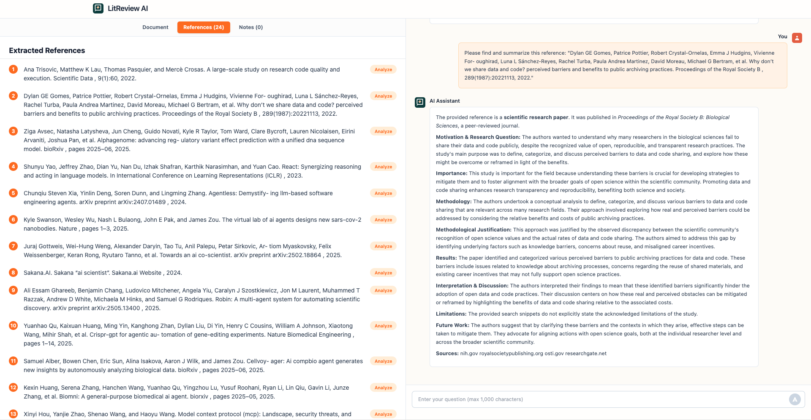

# 📚 Literature Review AI Assistant

<div align="center">
  
  
</div>

<div align="center">
  <em><small>Note: The papers shown in the screenshots above are for reference purposes only.</small></em>
</div>

A sophisticated web application designed to streamline the literature review process for researchers and students. This AI-powered tool helps users analyze academic papers, extract key information, and synthesize notes into comprehensive summaries. By leveraging Google's Gemini AI model, the application provides intelligent assistance throughout the entire literature review workflow, from document analysis to note synthesis.

## ✨ Features

### 📄 Document Analysis
- **PDF Upload & Processing**: Upload research papers in PDF format with automatic text extraction
- **Interactive PDF Viewer**: Navigate through documents with zoom controls and text selection
- **Figure & Chart Analysis**: Select visual elements to get AI-powered explanations

### 🤖 AI-Powered Content Analysis
- **Paper Summarization**: Generate structured summaries covering motivation, methodology, results, and implications
- **Reference Extraction**: Automatically extract and list all references from research papers
- **Reference Analysis**: Analyze individual references using Google Search to provide detailed summaries
- **Interactive Q&A**: Ask questions about paper content and get context-aware answers

### 📝 Note-Taking & Synthesis
- **Manual Note Creation**: Save important insights and excerpts as personal notes
- **Note Synthesis**: Combine multiple notes into a structured, comprehensive document
- **Organized Note Management**: Categorize notes as manual or synthesized with easy access

### 🎨 User Interface
- **Three-Pane Layout**: Document viewer, references list, and notes sections
- **Modern Design**: Clean, professional interface with smooth animations and transitions
- **Responsive Interactions**: Intuitive controls with hover effects and loading states

## 🏗️ Architecture

### 📁 Project Structure
```
litreview-final/
├── components/           # React UI components
│   ├── ChatWindow.tsx   # Chat interface with AI assistant
│   ├── FileUpload.tsx   # File upload component
│   ├── LoadingSpinner.tsx # Loading indicator
│   ├── NotesList.tsx    # Notes management interface
│   ├── PdfViewer.tsx    # PDF document viewer
│   ├── ReferencesList.tsx # References display and analysis
│   ├── ResultsDisplay.tsx # Results display component
│   └── WelcomePlaceholder.tsx # Welcome screen
├── services/            # Business logic and API services
│   └── geminiService.ts # Integration with Google Gemini AI
├── assets/              # Static assets
│   ├── logo.png
│   ├── logo.ts
│   ├── overview.png
│   └── overview2.png
├── App.tsx              # Main application component
├── constants.ts         # Application constants and prompts
├── types.ts             # TypeScript type definitions
├── index.html           # HTML template
├── index.tsx            # Application entry point
├── metadata.json        # Project metadata
├── overview.png         # Application screenshot (moved to assets/)
├── overview2.png        # Application screenshot (moved to assets/)
└── vite.config.ts       # Vite configuration
```

### 🛠️ Technology Stack
- **Frontend Framework**: React 19.2.0 with TypeScript
- **Build Tool**: Vite 6.4.1
- **AI Integration**: Google Gemini AI (@google/genai 1.24.0)
- **PDF Processing**: PDF.js for document rendering and text extraction
- **Markdown Rendering**: react-markdown with remark-gfm for formatting
- **Styling**: Tailwind CSS for modern, responsive design

### 🔧 Key Components
- **App.tsx**: Main application component managing state and coordinating all features
- **geminiService.ts**: Core service handling all AI interactions with Gemini API
- **PdfViewer.tsx**: Advanced PDF viewer with text selection and area selection capabilities
- **ChatWindow.tsx**: Interactive chat interface with markdown rendering and note-taking features
- **NotesList.tsx**: Note management with synthesis capabilities and animations
- **ReferencesList.tsx**: Reference extraction and analysis interface

## 🚀 Getting Started

### 📋 Prerequisites
- Node.js (v18.0.0, v20.0.0, or v22.0.0+)
- A Google Gemini API key (obtainable from [Google AI Studio](https://ai.studio/))

### 💾 Installation

1. Clone the repository:
   ```bash
   git clone https://github.com/THU-SIGS-AIID/2025-AIID-HACKATHON-PERSONAL-PROJECT-William-Archieta.git
   cd 2025-AIID-HACKATHON-PERSONAL-PROJECT-William-Archieta
   ```

2. Install dependencies:
   ```bash
   npm install
   ```

3. Run the development server:
   ```bash
   npm run dev
   ```

4. Open your browser and navigate to `http://localhost:3000` (or the port shown in your terminal)

### 📖 Usage

1. **Enter API Key**: Input your Gemini API key in the field at the top of the application
2. **Upload PDF**: Click the upload area or drag and drop a research paper PDF
3. **Analyze Document**: Wait for the app to process the document and extract references
4. **Interact with AI**: Use the chat interface to ask questions about the paper
5. **Select Text**: Highlight text to summarize or explain specific sections
6. **Analyze References**: Click "Analyze" on any reference to get detailed information
7. **Save Notes**: Save important insights as notes for later synthesis
8. **Synthesize Notes**: Click the synthesis button to combine notes into a structured document

## 📜 License

This project is part of Tsinghua SIGS Open Fiesta AIID program 2025. The project is provided for educational and research purposes.

## 🤝 Contributing

Contributions are welcome! Please feel free to submit a Pull Request. For major changes, please open an issue first to discuss what you would like to change.

## 🆘 Support

If you encounter any issues or have questions about the application, please open an issue on the GitHub repository.
